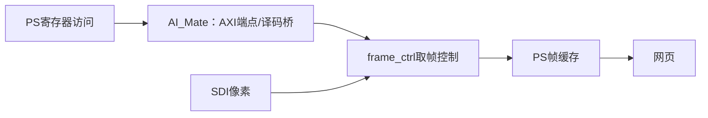

# 板卡资料复核与本次无响应事故

**最新状态**：经用户授权，BOOT 已恢复为厂商原版 `aca4612b…`，SDK 初始化和控制
寄存器正常，VTC 测试帧已到接收端，真实 SDI 仍未出帧。详见
[恢复与通路验证](board-factory-restore-20261014.md)。下文是切换前的分阶段记录。

**2026-10-14 后续实测更新**：板子已恢复 SSH；只读取回的 BOOT.bin MD5 确认为
`0f4f00e1de0af8f70299572be622e45a`，SDIS 状态序号持续增加。旧 SDK 程序已禁用，
保护版已编译部署；本轮没有替换 BOOT 或重启。详见 [恢复记录](board-recovery-20261014.md)。
以下“当前仍超时／BOOT 尚未核验”的文字保留为前一阶段事故记录，不再代表最新状态。

## 结论与责任

本次取帧试验使用的 SDK 入口与仓库已经记载的危险操作相同：
`Device::Open("axi://zg330aiu?npu=0x40000000&dma=0x80000000")`。
“没有装模型”不等于“不会触碰 NPU／AXI 端点”。在当前位流身份未确认前启动这个入口，
是本次操作的验收缺口；不能再把依赖解析、--help 或配置校验当作硬件初始化兼容证据。

资料给出了强匹配机制，但**本次启动实际加载的 BOOT 尚未取回校验值，最终根因仍待闭合**。
板子当前 TCP22 仍超时；本轮复核没有再次调用 SDK、访问硬件寄存器、切换位流或改启动分区。

## 资料身份

用户指定仓库：`https://github.com/takomitkm/WCIS-FPAI-FPGA-md`。
本次远端 HEAD：`29e0502f13535153e6b1f56d91944df35b92bbd7`。
GitHub连接对仓库返回404，但本机Git认证可读取；通过Git取树和定向blob获取资料，
没有覆盖 `C:/Users/anxianji/WCIS-FPAI-FPGA-md` 的旧副本及其未提交改动。
副本位于 `outputs/board-reference-20261014-current`；只定向取硬件和取证文件，未取全库大镜像。
旧本地HEAD为d676b11…，其中“Lite／尚未到板”等口径已落后，不再用于当前板型判断。
本轮不采用旧项目方案；文档中的历史实测也不自动代表当前启动状态。

## 与事故直接相关的证据

1. `md/技术文档/BOOTbin位流替换手术.md` §七：记录2026-10-13 15:30 UTC换入
   不含NPU、带SDI状态导出的 `ai7030_lite_pd1_20261012_211546.bit`；
   15:51实测 `BOOT.bin` MD5为`0f4f00e1de0af8f70299572be622e45a`。
   文档同时记录厂商原版`BOOT.bak` MD5为`aca4612b566738350a8c5edac0db1929`，包含NPU。
   **这是仓库记录，不是本轮已读取的卡上值。**
2. `md/技术文档/位流构建与SDI信号检测.md` §4.2：AI_Mate承担PS→PL寄存器透明桥，
   不是只负责推理。删除它会让0x40000000窗口失去AXI端点；同样的axi设备入口
   曾造成SSH与串口一起无响应。不能用“直接读/dev/mem”绕过缺失的总线端点。
3. `md/技术文档/NPU调用链.md` §二：Device::Open动态加载`libaxizg330aiu.so`，
   映射/dev/mem与/dev/udmabuf0，后者128MiB、两个寄存器窗口各16MiB。
   该动态协议库不在应用ldd的直接依赖列表里。ldd全找到不是这一步的兼容性验证。
4. 本地`outputs/camera-preview/board-capture.log`：最后日志为SDK设备初始化的版本信息标题，
   没有frame/read_us/sent记录；50秒通道超时，随后SSH/ping无响应，电脑接收0帧。
5. 本次预检16:09 UTC报告up39min，倒推启动约15:30，与仓库换位流时间相符。
   **该时间对应只是旁证，不能代替BOOT/加载日志核验。**

因此，**“不含NPU的位流＋会访问NPU/寄存器桥的SDK初始化”是当前最有依据的原因候选**。
没有本次故障后的心跳/内核/串口，不能进一步宣称已经捕获具体MMIO地址或内核等待位置。
恢复后先只读取BOOT身份、启动日志和心跳；不直接重复硬件初始化。

“模型暂时没有”只影响推理结果，不消除图中寄存器桥的硬件依赖。

## 当前应采用的板卡口径

| 项目 | 本轮核对的资料事实 | 当前限制 |
|---|---|---|
| 板型 | 悟净FMQL30TAI完整版；DT的FMQL100TAI型号串是共用参考树 | 不能按旧Lite配置表判断接线 |
| CPU | 4核Cortex-A53，MIDR0x410fd034，规格最高1GHz | 是规格/历史取证，不是本次频率实测 |
| RAM | PS1GB，PL2GB；最新预检PS约993MiB、可用约750MiB | PL DDR不是CPU可直接当普通RAM使用 |
| SDI | 完整版4入1出，接口125Mbps–2.97Gbps，GT与SFP/PCIe/SMA互斥 | 接收器能力不等于当前位流全部制式都正确 |
| 当前参考采集 | 单路RX，只连接FMC_HPC_DP0；资料对应XS1→LMH0344→SDI0_RX | 四个物理输入不能随便换口就期待有帧 |
| 网口 | 完整版两路，资料中现有软件栈仅PS eth0可用 | 本次已验证192.168.1.113到电脑接收服务 |
| 内存限制 | 板端资料实测cgroup资源控制器缺失 | MemoryMax不能充当保护；RLIMIT_AS也不能防AXI阻塞 |
| 存储 | 2026-10-15实测：SD 62,723,719,168 bytes；另有PL引脚连接的32GB eMMC，设备报告31,268,536,320 bytes | 旧表只列配卡信息，遗漏eMMC；已启用并迁移人员库，见[eMMC记录](face-emmc-store-20261015.md)，未做全容量破坏性扫测 |

上表来自当前`device/芯片.md`、`device/板子（除芯片）.md`及本地板端预检；
不采纳其中旧方案的JPEG、模型或音频分工结论。

## 另外两处必须修正的设计前提

- **SDI状态接口已存在于另一路当前设计**：仓库记录纯视频位流将SDIS状态写到
  `/dev/udmabuf0`首4KiB，magic0x53444953、seq与160bit状态。我的本地参考源码
  没有该接口，不能据此说当前板上“没有自动检测出口”。这条出口能判断信号，
  但不自动恢复已经丢失的取帧控制桥，也不等于完整摄像头帧。
- **不要与状态块共用缓冲页**：该设计把帧起始从0x30100000挪到0x30101000，
  预留首4KiB；原预览程序的通用udma分配并未核对这项布局，不能复用到该位流上。
  当前状态读程序是板上已有的`/root/sdi_stat.py`，资料建议从udmabuf读并做缓存维护。
  恢复后先审查源码，再决定只读状态路径；不照抄/dev/mem兜底命令。
- 资料还记载状态更新实为1ms而不是设计注释的100ms，不能据此承诺完整采集时序。
- 资料有VPU硬编码成功的历史取证，前轮“只有源码、未核实可用”仅描述我的检查范围，
  不能变成“该板硬编码从未跑通”。是否复用须核对当前驱动/缓冲契约，暂不新增硬件试验。
- 历史COM6/115200记录不等于当前PC已接串口；本轮Win32_SerialPort及CP210x设备枚举为空。

## 下一步与禁用项

当前已部署的SDK预览应用**不适用于上述纯视频位流**；本地执行器已阻止再次运行。
需先恢复连接，核对实际加载位流与桥存在性，取得故障前心跳/启动/串口证据。
只有在兼容关系确定后，才选择保留既有桥的采集，或为纯视频设计补齐独立控制通路。
**不自动恢复BOOT.bak，不改引导分区，不用直接MMIO再试一次，不盲目开启NPU/摄像头。**
