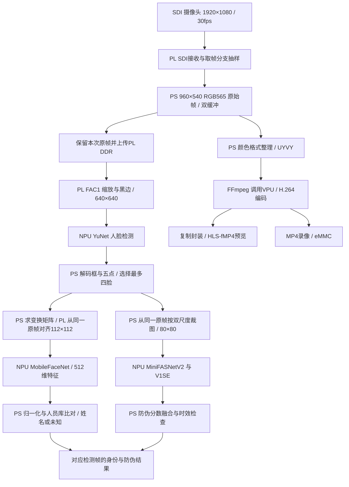

# 工程流程与架构（2026-10-31 梳理）

本文说明当前视觉工程，不把旧的多模态规划当成已部署功能。依据为当前本地源码、10月30日至31日发布/验收记录，以及 D:/xiangmuwendang 的补充资料。本轮只做文件核对，没有连接板卡重新验证运行状态。

## 系统位置与分工

项目整体按 ModelBackend（模型与硬件能力）、OrchestrationLayer（事件与业务调度）、WebFrontend（交互展示）划分。当前工程聚焦视觉 ModelBackend，已有用于验证、管理的网页和录像服务；这不代表完整多模态业务调度已经完成。

| 单元 | 当前职责 |
|---|---|
| PL / FPGA 可编程逻辑 | SDI接收、取帧分支整数抽样、FAC1缩放/黑边/五点仿射采样、DDR访问与硬件握手 |
| NPU | YuNet检测、MobileFaceNet特征提取、MiniFASNet双模型推理 |
| PS / ARM Linux | 设备所有权、取帧与缓存、几何矩阵求解、张量整理、检测解码、身份比对、防伪裁图与融合、HTTP和存储管理 |
| VPU | H.264硬件编码；由PS侧FFmpeg调用，是独立于自研PL预处理的硬件单元 |
| 网页 | 实时预览、对应检测帧结果、照片登记/识别、录像管理与回放 |

## 当前数据流程

图中身份与PAD画成逻辑分支，逐脸共享检测结果和原帧，不表示两个NPU分支同时执行。身份链路先检测，再逐脸对齐和特征提取；PAD处理身份链路已选择的最多四张脸。没有人脸时不会运行完整逐脸模型链路。

FAC1是自研人脸预处理的CustomOp接口。PS提交原帧地址、尺寸、步长及逆变换等参数，PL从DDR读取像素，执行双线性采样、边界与补边处理，输出供后续模型使用的像素。矩阵求解、模型张量转换与结果解释仍有PS参与。原始帧存在PS缓冲和上传过程，不能称为摄像头到NPU零拷贝。

PAD即人脸呈现攻击检测。当前使用PS裁图与NPU双模型；`wcis_pad_preprocess.v`虽有独立仿真记录，但尚未接入现役整板路径。PAD模型证据链已接入，安全阈值与现场误放误拒尚未校准，不能作为开锁许可。

## 软件组织与设备访问

8091 `serve_photos.py`承接主页面、照片/摄像头识别及登记，通过`camera_owner_runtime.py`控制原生`wcis_camera_owner`。后者作为唯一iCraft SDK设备所有者，统一管理采集、FAC1及NPU访问，缓存模型会话。浏览服务8092共享其输出；录像服务8093独立管理媒体与索引，不另开一套SDK采集。H.264由外部FFmpeg调用VPU，另一个FFmpeg复制封装，不做第二次视频编码。

持续采集使用已有PL取帧分支、双缓冲和采集工作线程。识别取最新可用帧并保留其生命周期，不无限积压历史帧。并发网页摄像头请求可以合并共享结果；boot/session/frame/hash与时效检查保证框、身份、PAD指向对应原帧。实时视频和检测结果更新速度不同，网页分别展示实时画面与对应检测帧，避免把旧框叠到新画面。

## 源码入口

| 路径（相对fpga_project） | 作用 |
|---|---|
| `case/rtl/ai7030_edif_top.v` | 厂商整板顶层与CustomOp接入 |
| `rtl/wcis_face_customop.v` | FAC1控制与整板接口 |
| `rtl/wcis_face_preprocess.v`、`wcis_affine_sampler.v`、`wcis_pixel_read_axi.v` | 原帧读取、几何采样与预处理 |
| `ps_app/src/wcis_camera_owner.cpp` | 原生SDK设备所有者及采集/模型命令 |
| `npu_photo/camera_owner_runtime.py`、`camera_requests.py` | 所有者生命周期、帧租约与请求共享 |
| `npu_photo/pl_preprocess.py`、`recognize_frame.py` | PL适配、检测/对齐/特征/人员库比对 |
| `npu_photo/owner_pad.py`、`model_backend/face_pad.py` | 同帧PAD裁图、调用及融合合同 |
| `lan_stream/external_h264.py`、`vpu_live_server.py` | H.264编码进程集成与预览服务 |
| `npu_photo/recording_service.py`、`recording_library.py` | 录像写入、索引、管理与回放 |
| `release/540p-r2/`、`docs/release-source-map.md` | 当前保存的发布基线与来源对应 |

目录不是严格的软件分层边界：ModelBackend实现分散于model_backend、npu_photo、ps_app及rtl，不能只看同名目录判断后端范围。存在PL JPEG、PL网络发送和PAD裁图源码，也不等于这些路径已正式部署。

## 开发与交付流程

先确定模型输入输出合同（尺寸、颜色、量化/归一化、坐标、阈值及帧归属），再用成熟参考生成对照数据；分别验证PL像素、NPU原始输出及PS后处理，最后接同帧整体链路。

需要模型导出、转换、校准、编译或AArch64交叉编译时，先重新检查学校服务器连接、工具与运行任务，在`D:/yzd/tmp/<task>`隔离目录构建，共享工具只读。RTL改动需依次经过仿真、综合、布局布线、位流和BOOT打包，再做板端验证；软件改动按影响范围做回归、发布清单与板端输出比较。发布前保留旧版和回退材料，安全关闭唯一设备所有者后切换，完成新版本验收并归档。各阶段证据不能相互替代。

## 当前证据边界与资料冲突

- 本地10月31日发布资料记录现役为540p H.264 r2；72次固定单脸原帧回放输出一致，新MP4的240帧完整解码通过。有限观察预览接近30fps，不等于每秒识别30次。
- 现场画面接近全黑，正常光照/有人脸、运动画质、长期压力及r2整板重启仍未完成专项验收。完整1080p采集、VPU、NPU共存尚未通过。
- PAD安全校准、整板NPU最小周期告警、完整PL DDR容量扫描尚未闭环。
- `D:/xiangmuwendang/WCIS-FPAI/wiki/todo/路线要更新/系统架构总览.md`仍描述USB摄像头和候选模型，应作为旧规划理解；不能覆盖当前SDI、YuNet、MobileFaceNet和双PAD实现。
- `D:/xiangmuwendang/WCIS-FPAI/repos/FPAI30TAI图像FPGA`为补充快照，其JPEG阶段描述早于本地H.264发布记录。音频/NLP/LLM/OCR属于团队整体范围，本次没有核实其当前完整运行状态，不计入此视觉工程交付。

主要本地文档依据：`README.md`、`docs/acceptance-20261030.md`、`docs/release-runbook.md`、`docs/release-source-map.md`、`docs/preview-maintenance-deploy-20261031.md`、`docs/face-camera-owner-20261021.md`、`docs/face-pl-modelbackend-20261015.md`及`docs/h264-ffmpeg-20261030.md`。历史文档仅用于解释对应实现，当前状态以较新的发布与验收记录为准。
