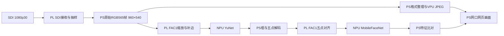

# 摄像头、FAC1、NPU和VPU单所有者接入（2026-10-21）

同日后续已部署[双缓冲提前取帧与持续视频](face-stream-smooth-20261021.md)，正式应用改为camera-smooth-20261021，空闲推流接近30fps。以下保留初版单所有者接入时的路径、5fps设置和验收范围。

本轮承接10月20日晚间的识别延迟优化。10月21日已将通过验收的原始RGB565输入路径切换到正式8091服务。识别过程中不再停止采集服务，也不再先编码JPEG、再解码JPEG作为模型输入。只保留最新摄像头帧；检测结果与其取样帧绑定。

日期依据：学校构建和初版试验从10月20日晚间开始，最终构建、接口验收、正式软件切换及以下结果均为本地10月21日。任务目录继续使用 `D:/yzd/tmp/face-camera-owner-20261020`，不能据目录后缀将最终验收记作20日。

## 当前处理链路与职责

1. 普通SDI摄像头输入1920×1080、30fps，经项目PL的SDI接收与整数抽样，PS取帧分支取得960×540 RGB565。
2. 单一原生进程保持SDK设备、分配器和VPU实例，由同一线程在PL/NPU命令之间采集新帧。识别取最新原始RGB565快照，并保留同一帧对应的JPEG用于显示。
3. 原始RGB565仍经过PS缓冲及一次上传到PL DDR；FAC1完成缩放、黑色补边，得到YuNet输入。仍有PS张量整理、输出读回，不是摄像头到模型的纯PL零复制。
4. NPU运行YuNet；PS解码检测框、关键点及坐标。FAC1从该请求保留的原帧完成五点仿射对齐至112×112。
5. NPU运行MobileFaceNet，PS归一化512维特征并与已有人员库比对，返回姓名/未知。每帧最多识别4人，沿用原后端逻辑，未调整阈值以使样本通过。
6. 显示分支由PS整理RGB565/BGR/YUV，再交现有VPU编码JPEG，经PS网口eth0提供8091页面和8092预览。这里使用VPU，**没有将独立PL JPEG核接入真实摄像头直播，也没有部署新的FAC1/JPG1公平仲裁RTL**。

页面的自动检测连续发起下一次请求，不堆积待识别帧。检测画面以结果速度更新，框只叠加在本次识别的对应JPEG上；“只看实时画面”读取最新预览，不复用旧框。编码采集上限仍为5fps，不能将1080p30摄像头输入解释为30fps网页或30fps识别。

## 位流与正式服务

- 当前BOOT SHA256：`f6da96abbc0144ce5a48f4fa85aed6dab65067211b8932e8f4e4db87d5110297`。
- 当前启动身份：`8f360a28-0740-4d81-a13f-379a20faf47e`。启动证明与当前boot_id一致；正式切换的启动前检查重新只读挂载SD并核验BOOT、DTB及uEnv，随后卸载。
- 该BOOT是项目修正版，包含此前FAC1双行缓存及SDI参考输入修正。依据 [SDI修正记录](sdi-refclk-fix-20261020.md)，不是恢复原厂位流。未发现 `/download.bit` 覆盖启动位流。
- 本轮只修改PS侧程序和服务，**没有重写BOOT、重新编译模型或修改RTL**。最终软件切换后没有再重启整板，不能将配置的开机启动称作本轮已完成重启验收。
- 正式应用：`/root/wcis-face/apps/camera-owner-20261021`；模型发布目录仍为 `/root/wcis-face/releases/20261014-b5a454c11d22`。
- `wcis-face-photo.service` 已启用且运行，8091同时承接摄像头、照片识别与登记。启动前执行已有 `boot_prepare.py`，故障不自动重启SDK。
- `wcis-sdi-camera-live.service` 已停止并禁用，因为采集并入单所有者进程；这不表示当前摄像头采集关闭。
- `wcis-sdi-vpu-view.service` 已启用且运行，8092读取新所有者发布的控制文件。
- 候选8093已停止。停止时累计采集1926帧、编码1926帧，最后回执 `sdk_closed=true`，确认排空并退出后才启动正式进程。
- 正式人员库仍在eMMC原目录，切换及正式验收后6个文件校验与切换前完全一致。

## 实现与故障修正

原生入口 `ps_app/src/wcis_camera_owner.cpp` 持有唯一设备与分配器；`wcis_owner_kernels.hpp` 复用原FAC1和缓存模型计算；`wcis_owner_vpu.hpp` 沿用原VPU缓冲契约。CMake目标由 `WCIS_BUILD_CAMERA_OWNER=ON` 显式开启，默认关闭，不改变既有通用构建入口。

Python `npu_photo/camera_owner_runtime.py` 管理启动证明、哈希、硬件锁、帧租约与命令回执，持续读取原生日志，防止没有HTTP请求时stdout填满。模型、几何、帧号、帧令牌、boot和进程身份均校验；每次输入输出文件限于所属tmpfs目录，源帧有边界守卫。照片使用单独的高位帧号序列，避免同进程缓存误认成上一张照片。

`serve_photos.py` 通过显式所有者参数启用新通路。`pl_preprocess.py` 接收可注入worker；原照片后端继续可用。摄像头请求的原帧、对齐和临时输出放tmpfs，请求结束清理；正式人员登记持久化规则不变。

此前失败版本保留，未将其计为成功：

| 试验 | 观察 | 修正与验证边界 |
|---|---|---|
| v1 | 每个命令重新打开设备，采集恢复后源帧守卫不一致 | 拒绝继续复用该SDK状态；恢复原服务后重新设计单设备所有者 |
| v2 | 双模型预检中YuNet后MobileFaceNet输出同步失败，包含 `device_layer_count:90` | 对照厂商 `multinets_npu_actor.hpp` 的输出等待与 `device_.reset(1)` 顺序，在全部输出导出后执行同样的完成复位；不是猜测寄存器地址 |
| v3 | 双模型预检通过，但摄像头采集后源帧守卫变化，阶段 `capture_after` | 厂商GenericSDICamera构造会同时开启旧PL ImageMake分支。改为按厂商寄存器契约仅设置PS取帧分支，旧PL的 `img_en` 保持0，避免覆盖保留区 |
| v4 | 有界真实采集、模型、源帧及5组旧版精确对照通过 | 接入HTTP前的原型验收，不等同正式部署 |
| v5 | 增加持续运行入口和日志读取，学校构建、候选HTTP与正式切换通过 | 本次正式部署版本 |

前3轮均隔离失败状态，正常重启回到未改BOOT及原服务后再试，未在板端编译模型。原型失败不能称为已跑通。v3后的启动为当前 `8f360…`，后续成功试验及软件切换未再重启。

## 构建与验收证据

学校服务器独立任务：`D:/yzd/tmp/wcis-camera-preview-owner-0f5b3c41`；使用共享工具只读交叉编译，产物不是板端现场编译。

- 源码归档SHA256：`454b70d86c8791886aa9e7280b043c7ac24826e4d5fb7e6861d50378e44a4d77`。
- 最终原生程序SHA256：`ca68d1f14701f8bdbfc150a9791be29bc66d34ba739d5afd092d5e1db8a08ea7`。
- 原型v4：8次桌面无人脸摄像头识别约388–438ms，每次期间有1–2个新预览帧；短测4.85fps。单人、双人、无人脸固定样本重复一致；5组与旧后端的原始模型输出哈希、框及身份结果完全一致。
- 候选HTTP：12次摄像头画面均检测到1人，中位约594ms，每次识别期间预览继续推进；预览最大采样间隔0.328秒。照片0/1/2人重复输出一致，坏图400、多脸登记422。独立人员库登记→识别→删除通过，未用正式库做增删试验。
- 正式HTTP与eMMC短时共存：12次摄像头无人脸请求中位约432ms；每次请求内均记录到更新的预览帧。期间另有单人、双人、无人脸照片识别通过；同一原生PID保持1090。
- 同一正式试验写入60帧MJPEG共2,538,011字节，约4.82fps、最大间隔0.289秒；所有JPEG先解码，再从eMMC逐段读回校验并重新解码通过。挂载UUID核对为原eMMC。该负载包含HTTP读取及解码，不是VPU纯编码吞吐。
- 正式验收首轮因测试脚本引用不存在的fixture路径中断；不是服务/硬件失败。保留不完整输出和短录像，修正到独立fixture目录后完整重跑。不能将第一次中断测试计入60帧通过结果。
- 浏览器确认8091自动检测更新、暂停成功，并保存 `live-owner-20261021.png`。正式应用清单哈希、人员库校验、当前启动身份和请求临时目录清理通过。

不同场景、入口和负载的时间不能直接相除宣称统一加速倍数；无人脸不运行特征模型，单人会运行，HTTP时间也不是NPU纯计算耗时。

本地证据目录：`D:/yzd/tmp/face-camera-owner-20261020`，关键文件为 `build-receipt.json`、`prototype-verification-v4.json`、`http-verification.json`、`formal-promotion.json`、`formal-verification.json`、`formal-camera-result.json`、`live-owner-20261021.png`，以及各失败版本的verification/fault/build日志。板端同名候选目录保留切换前配置、单元、应用清单和站点备份，eMMC录像仅为有界验收文件。

## 回退与未完成事项

软件回退必须先停止正式HTTP、等待SDK排空并核对最后 `stopped/sdk_closed` 回执；若当前启动存在硬件隔离标记，不直接重新打开SDK。备份位于板端候选目录的 `service-before.json`、`service-before-config.json`、`formal-backup/`。恢复旧全局配置、旧deployment清单、原服务单元和站点文件后，才重新启用旧采集服务及旧照片服务。BOOT无需改变。旧的原厂BOOT回退入口不适用于这次软件切换。

当前完成的是**真实摄像头下采集、识别、VPU编码及短时eMMC写盘可共存的底层通路**。录像仅为验收脚本，没有新增常驻事件录像、配额/保留策略、断电恢复或长期稳定性保证。纯PL直通、PL JPEG真实采集接入、公平仲裁RTL、高帧率、多客户端负载及新服务的整板重启验收均未在此完成。

普通摄像头活体防伪仍标记 `not_evaluated`，没有接入MiniFASNet并完成真人/纸照片/手机回放对抗验收。姓名匹配不能作为活体通过或自动开锁依据。学校资料 `D:/xiangmuwendang/WCIS-FPAI/wiki/PL/plvid.md` 的简介仍写SFace，而模型章节及实际发布/源码使用MobileFaceNet；本记录依据实际运行模型，保留资料差异。
