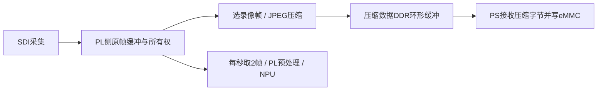

# PL JPEG 压缩原型：可行性、实现与验证

日期：2026-10-16。目标为独立 ModelBackend 压缩核，后续供1080p、目标20 FPS录像使用。
本轮完成真实RTL仿真、独立综合/布局布线；没有生成整板位流、改BOOT、上板或写eMMC。
不得把下述周期换算称为实板持续录像帧率。

## 可行性结论

逐帧baseline JPEG彩色4:2:2适合作为第一版PL压缩原型：不存运动参考整帧，采用行缓冲，
输出每帧一个可被通用JPEG解码器读取的完整JFIF文件。连续保存JPEG帧可构成MJPEG录像；
具体记录封装、时间戳、DMA、文件分段/容量策略仍需后续接入。

压缩核复用 [mjpegZero](https://github.com/lcapossio/mjpegZero)，固定commit
`90bc0c46d2c2c4bda1020113f306a5f17dcc5f2f`。没有把作者的资源/帧率当作本板结果。
选型时排除了需405 BRAM36K的MPEG-2参考配置：该配置已经超过本项目代理目标整片265块。
本次JPEG核心实际1080p、RGB输入、Q75独立综合为2622 LUT、1224 FF、16 BRAM36、29 DSP。
与现有整板39833 LUT、156.5 BRAM的历史报告比较，资源规模有整合可能；简单相加不能证明整板布局布线可行。

上游许可为Apache-2.0附Commons Clause v1.0，**不是无额外限制的Apache-2.0**。
原LICENSE、源码声明及逐文件SHA均保留；教育/研究原型在许可列明范围内，商业集成需另核对许可。
本地改动位于独立适配器，vendor RTL未修改。

## 真实RTL性能与大小

以下均是Icarus运行编码RTL得到的JPEG，Pillow完整解码且尺寸正确；不是CPU编码的结果。

| 输入 | JPEG大小 | 编码周期 | 100 MHz下周期折算 |
|---|---:|---:|---:|
| 1920×1080，公开视频第200帧放大，Q75 | 69,056 B | 4,163,570 | 41.64 ms/帧，约24.02 FPS |
| 1920×64，独立RGB随机噪声，Q75 | 107,305 B | 262,046 | 仅此条带，不是1080p整帧帧率 |

首个视频原生只有768×432、12 FPS。放大输入证明1080p像素数量下的功能与该场景周期，
不证明真实1080p的细节、20个不同采集帧/秒或长时间吞吐。其RGB PSNR约47.64 dB，
压缩比对RGB24约90.1:1、对RGB565字节数约60.1:1；这些结果受放大后平滑背景影响，不能泛化。
若相同大小持续20 FPS，写入负载约1.38 MB/s；仅为该样本的算术换算。

噪声条带表明JPEG没有固定码率。按其字节/像素粗略外推1080p，约1.81 MB/帧、20 FPS约36.2 MB/s，
这不是1080p整帧实测，却已足以提示容量和带宽风险。不能承诺所有画面都以同一大小保存。
2026-10-15 eMMC记录为PIO、4-bit、25 MHz SDR，名义数据线带宽12.5 MB/s，实际持续文件写入会更低；
本轮没有重测驱动状态/写盘速度。高熵画面要降低质量、降低录像帧率或采用其他编码方案，
不能让缓存无界增长。32GB最终仍会写满，需录像配额/分段，人员库须预留空间。

证据目录均在 `D:/yzd/tmp/pl-jpeg-20261016`：

- `core-video-1920x1080-q75/result.json`、`simulation.log`、`sim_output.jpg`、`decoded.png`。
- `core-noise-1920x64-q75/result.json`，噪声是固定seed生成的原生测试图。
- `synthesis-core/`为核心可行性综合；`synthesis-adapter/`为完整适配器独立实现报告。

## 本地接口实现

`rtl/wcis_jpeg_compressor.v`：默认1920×1080、Q75、4096字节输出FIFO，单时钟、同步高有效reset。

- `cmd_valid && cmd_ready`接收一个frame_id，并独占后续恰好宽×高个RGB24像素。
- `s_valid && s_ready`才接收像素，格式为`{R,G,B}`、逐行扫描。输入端可插空拍，遇反压必须保持像素。
- 适配器按像素计数生成上游核要求的SOF/EOL；不通过CPU进行JPEG编码。
- `m_valid && m_ready`输出JPEG字节；`m_sof/m_last`与首/末字节一同保持稳定，frame_id关联整帧。
- FIFO内将EOF与字节一起缓存；只有末字节实际交付后才增加`frames_done`，允许下一条命令。
- `last_frame_bytes/last_frame_cycles`记录已交付整帧。周期从命令到末字节交付，包含下游等待。
- 核心输出没有ready，不能靠小FIFO承诺无限反压。FIFO溢出时复位该编码会话、清空FIFO，
  发出`frame_abort`并增加`fifo_overflows/frames_aborted`，错误sticky，之后自动重新初始化接收新帧。
- `abort_frame`可终止缺少像素等未完成帧。接收方必须到有效EOF才提交文件/记录，
  收到abort时丢弃该frame_id的已交付部分；reset也使当前未完成记录无效。
- FIFO用分布式RAM实现，未声称它占BRAM。其作用是短暂解耦，不是磁盘写入缓存。

建议接线：



SDI像素流没有本模块的ready握手，不能把压缩核直接串上去后忽略反压。
后续复用官方采集、DDR与DMA接口，给两个消费者独立帧引用/归还；原图暂存不等于长期保存原图。
识别仍取原始采集帧，不先压缩再解码回NPU，避免给人脸识别增加JPEG损失和解码开销。
录像帧控制和2 FPS识别调度先保留上述契约，未扩展OrchestrationLayer/WebFrontend。

## 验证结果与边界

`scripts/verify_jpeg_compressor.py`执行7组测试，共11个完整输出帧：

1. Q50/Q75/Q95，连续两张不同的彩色图，输入空拍与输出停顿。
2. 128×24、多行块、256字节FIFO、指针回绕。
3. 32字节FIFO强制堵塞，已交付50字节后abort，下一帧正常恢复。
4. 输入半途中显式abort，然后恢复。
5. 编码中reset，计数归零并成功编码下一帧。

每个完成帧不仅检查SOI/EOI和Pillow解码，还与同commit的软件编码模型进行逐块DC/AC系数比较，
最大差异≤1（定点舍入）。检查输出在反压期间保持字节、边界及frame_id稳定。
故意中断的frame_201等文件只是负向测试的部分字节，不能算成功录像。
源文件SHA在每次验证前与`sources.json`核对，软件参考checkout也核对commit及未修改状态。

首轮正常停顿测试使用32字节FIFO，JPEG头连续输出使其溢出；正常测试改用256字节，
保留32字节专测强制溢出。恢复测试发送器曾在空拍期间漏看单周期abort，
改为同时观察累计abort计数，避免测试发送器等待已取消帧。没有通过禁用溢出检查规避问题。

独立1080p适配器在Vivado 2018.3 / `xc7z030ffg676-2`完成布局布线。
最终为3592 LUT、1330 FF、16 BRAM36、29 DSP，100 MHz内部setup WNS +3.232 ns、
hold WHS +0.053 ns、WPWS +4.232 ns。对应最终源码的资源与内部时序见
`synthesis-adapter/routed-utilization.rpt`、`routed-timing.rpt`。
OOC报告不约束外部接口延迟，日志含未指定PARTPIN的端口警告；DRC保留DSP流水、OOC缺PS等警告。
这不是整板时序签收，更不证明SDI、DDR DMA、eMMC及NPU并发性能。没有生成可启动BOOT。

## 复现

参考checkout及生成物放在任务目录；不修改Downloads案例或共享工具。

```powershell
git clone https://github.com/lcapossio/mjpegZero.git D:/yzd/tmp/pl-jpeg-20261016/upstream
git -C D:/yzd/tmp/pl-jpeg-20261016/upstream checkout 90bc0c46d2c2c4bda1020113f306a5f17dcc5f2f
python D:/renlianshibie/fpga_project/scripts/fetch_jpeg_reference.py --source D:/yzd/tmp/pl-jpeg-20261016/upstream
# 在任务私有Python环境安装 scripts/requirements-jpeg.txt，iverilog/vvp需在PATH。
python D:/renlianshibie/fpga_project/scripts/verify_jpeg_compressor.py
python D:/renlianshibie/fpga_project/scripts/benchmark_jpeg_core.py --video D:/yzd/tmp/face-video-input/videos/head-pose-face-detection-female.mp4
# 或无视频依赖地生成原生尺寸测试图：--pattern noise / gradient / flat。
# 综合在任务目录运行，TMP/TEMP/TMPDIR也指向任务目录：
C:/Xilinx/Vivado/2018.3/bin/vivado.bat -mode batch -source D:/renlianshibie/fpga_project/scripts/synth_jpeg_compressor.tcl
```

本次依赖位于任务`deps/`，复用了现有视频私有Python环境中的NumPy/OpenCV；没有修改共享Python。
完整1080p核心测试用时约216秒（电脑仿真墙钟时间，不是硬件编码时间）。
新的可复用benchmark脚本以同一小帧重跑，834字节、3437周期及JPEG SHA与初始核心探针一致。

后台项目站点本轮复用Firefox仅该站点会话后HTTP200，项目正文已读取；认证数据未落盘/输出。
页面仍以PS采集示意作为架构说明，本文的PL采集接线是待集成目标，不把页面示意当作本板采集已验收。
